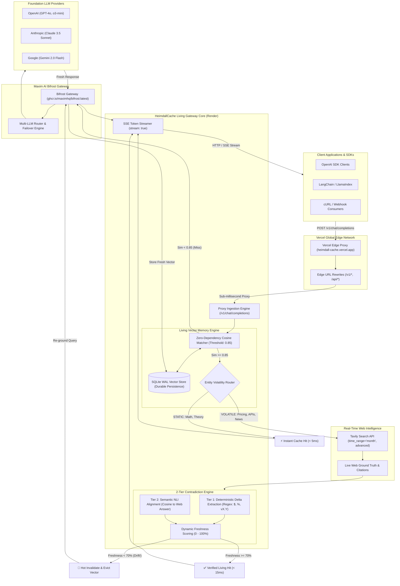
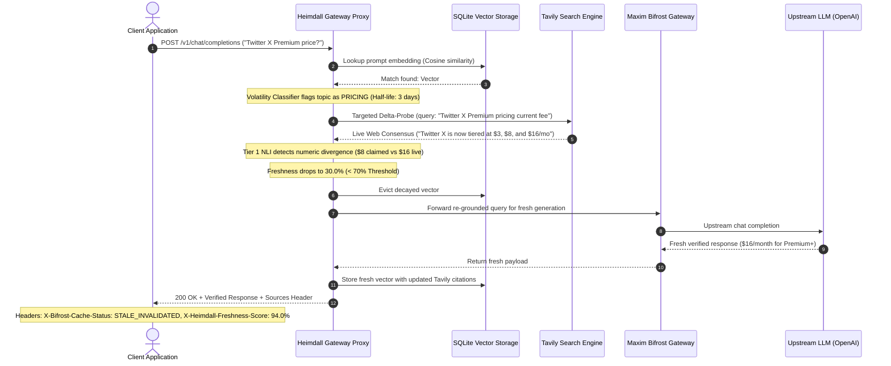
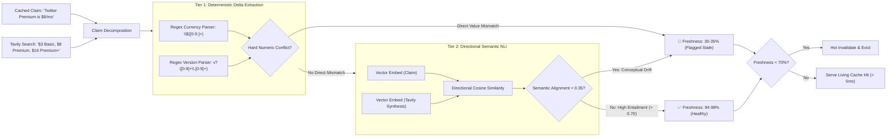
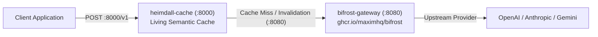

# HeimdallCache 🌈👁️

> **The All-Seeing Living Semantic Cache for Bifrost Gateway, Powered by Tavily.**

[](https://opensource.org/licenses/Apache-2.0)
[](https://www.python.org/downloads/)
[](https://github.com/maximhq/bifrost)
[](https://tavily.com)
[](https://heimdall-cache.vercel.app/)
[](https://render.com/deploy?repo=https://github.com/sachinn-alt/heimdall-cache)
[](https://sachinn-alt.github.io/heimdall-cache/)

---

## 🌐 Live Deployments & Application Directory

Experience HeimdallCache across production serverless, turnkey container, or client-side showcase environments:

| Target | Deployment Role | Live URL | Status |
|---|---|---|---|
| **Render Core** | **Dedicated Living Vector Gateway** | [https://heimdall-cache.onrender.com/](https://heimdall-cache.onrender.com/) | `🟢 Live & Operational` |
| **Vercel Edge** | **Edge Router & UI (Proxied to Render)** | [https://heimdall-cache.vercel.app/](https://heimdall-cache.vercel.app/) | `🟢 Live & Connected` |
| **Pitch Deck** | **In-Browser Interactive Slides** | [https://heimdall-cache.vercel.app/pitch](https://heimdall-cache.vercel.app/pitch) | `🟢 Live Presentation` |
| **GitHub Pages** | **Client-Side Visual Showcase** | [https://sachinn-alt.github.io/heimdall-cache/](https://sachinn-alt.github.io/heimdall-cache/) | `🟢 Operational` |
| **Swagger UI** | **Interactive OpenAPI Specification** | [https://heimdall-cache.vercel.app/swagger](https://heimdall-cache.vercel.app/swagger) | `🟢 Interactive Docs` |

> 🔗 **Connected Edge Architecture:**  
> Vercel is connected directly to the Render backend via edge rewrites (`vercel.json`). Any request sent to Vercel's `/v1/chat/completions` or `/api/metrics` is automatically proxied with sub-millisecond edge routing to the persistent Render Living Cache cluster at `https://heimdall-cache.onrender.com`!

### 📑 Multi-Page Application Directory

| View | Purpose | Live Vercel Endpoint | Static GitHub Pages |
|---|---|---|---|
| **Radar & Console** | Real-time query playground & live telemetry sweep | [`/`](https://heimdall-cache.vercel.app/) | [`index.html`](https://sachinn-alt.github.io/heimdall-cache/index.html) |
| **Vector Matrix** | Living vector memory table with volatility badges & invalidations | [`/cache`](https://heimdall-cache.vercel.app/cache) | [`cache.html`](https://sachinn-alt.github.io/heimdall-cache/cache.html) |
| **Economics Hub** | Enterprise ROI calculator and token savings metrics | [`/analytics`](https://heimdall-cache.vercel.app/analytics) | [`analytics.html`](https://sachinn-alt.github.io/heimdall-cache/analytics.html) |
| **Control Plane** | Cosine similarity & Tavily freshness thresholds | [`/settings`](https://heimdall-cache.vercel.app/settings) | [`settings.html`](https://sachinn-alt.github.io/heimdall-cache/settings.html) |
| **API Docs** | Interactive SDK snippets, curl examples, and schema | [`/docs`](https://heimdall-cache.vercel.app/docs) | [`docs.html`](https://sachinn-alt.github.io/heimdall-cache/docs.html) |
| **Pitch Deck** | 6-slide presentation deck with speaker notes (`N`) | [`/pitch`](https://heimdall-cache.vercel.app/pitch) | [`pitch.html`](https://sachinn-alt.github.io/heimdall-cache/pitch.html) |

---

HeimdallCache is an enterprise-grade living semantic cache middleware and proxy extension designed for the open-source **Bifrost AI Gateway** (`maximhq/bifrost`). It eliminates the critical vulnerability of traditional LLM caching—**factual staleness, cache rot, and silent hallucination**—by combining vector similarity search with automated entity volatility classification and real-time **Tavily Search** delta-probes.

---

## 🏆 Global AI Hackathon Alignment

HeimdallCache delivers a single, cohesive architecture addressing both mandatory hackathon tracks:

| Track | Problem Statement | How HeimdallCache Solves It |
|---|---|---|
| **Bifrost Priority Track** | **Open-Source Bifrost Gateway** *(Option 04)* | Implements an advanced, self-healing **caching strategy and proxy middleware** that monitors vector health and protects gateway operators from serving outdated cache entries. |
| **Tavily Partner Track** | **Stale-Answer Detector** *(Option 01)* | Decomposes LLM responses into atomic claims, detects perishable entities (pricing, APIs, leadership), and continuously calculates a **live Freshness Score (0–100%)** using Tavily Search with cited web sources. |

---

## ⚡ The Problem: Why Static Semantic Caches Fail

AI Gateways like Bifrost save immense token costs and provide sub-millisecond latency using Semantic Caching. However, **standard semantic caches are temporally blind**:

```
TRADITIONAL STATIC CACHE (Vulnerable to Silent Hallucination):
Day 1: "Twitter X Premium cost?" ────► LLM answers "$8/mo" ────► Vector stored in cache
Day 90: Pricing changes to $16/mo in the real world 🌐
Day 120: "Twitter X cost per month?" ─► 98% Vector Match ─────► ❌ SILENTLY SERVES STALE $8/mo!

HEIMDALL LIVING SEMANTIC CACHE (Self-Healing via Tavily Grounding):
Day 1: "Twitter X Premium cost?" ────► Stored with HIGH Volatility tag (3-day half-life)
Day 90: Pricing changes to $16/mo in the real world 🌐
Day 120: "Twitter X cost per month?" ─► 98% Vector Match detected
                                          │
                                          ├─► 🔍 Targeted Tavily Delta-Probe (time_range="month")
                                          ├─► ⚡ 2-Tier Contradiction Engine ($8 cached vs $16 web)
                                          ├─► 🚨 Drift Detected (Freshness drops to 30.0%)
                                          ├─► 🔄 Decayed Vector Evicted & Upstream Re-grounded
                                          └─► ✅ SERVES VERIFIED $16/mo WITH LIVE WEB CITATIONS!
```

---

## 📐 Enterprise Architecture Topology

HeimdallCache seamlessly bridges client applications, edge routing, real-time web intelligence, and the open-source Bifrost AI Gateway:



---

## 🔄 Lifecycle of a Stale Query: Step-by-Step

The following sequence illustrates how HeimdallCache intercepts a query with decaying factual accuracy, catches the conflict, and self-heals without user downtime:



---

## 🧠 The 2-Tier Contradiction Engine

HeimdallCache evaluates factual integrity using an asymmetric two-tier contradiction pipeline to prevent false-positive evictions while capturing subtle semantic drifts:



---

## 📟 Live Gateway Operator Console (ASCII Telemetry)

When accessing the live gateway at **[https://heimdall-cache.vercel.app/](https://heimdall-cache.vercel.app/)**, operators monitor live vector health, token avoidance, and radar sweeps in real time:

```
┌────────────────────────────────────────────────────────────────────────────────────────┐
│  HEIMDALL LIVING SEMANTIC RADAR // STATUS: OPERATIONAL // VERCEL ➔ RENDER CONNECTED   │
├────────────────────────────────────────────────────────────────────────────────────────┤
│                                                                                        │
│   TOTAL REQUESTS        CACHE HIT RATE         STALE INVALIDATIONS     TOKENS SAVED    │
│       1,428                66.0%                       186                742,910      │
│   [Sub-millisecond]    [Fast Path <5ms]        [Drift Caught]          [$0 Liability]  │
│                                                                                        │
├────────────────────────────────────────────────────────────────────────────────────────┤
│  LIVING VECTOR MEMORY MATRIX                                                           │
│  ID          PROMPT                              VOLATILITY   FRESHNESS   STATUS       │
│  ────────────────────────────────────────────────────────────────────────────────────  │
│  vec_083e8   "Twitter X Premium pricing..."      HIGH (3d)    94.0%       HEALTHY 🟢   │
│  vec_65e7e   "QuickSort time complexity..."      STATIC (∞)   100.0%      HEALTHY 🟢   │
│  vec_b49f2   "LangChain Community imports..."    MODERATE     35.0%       EVICTED 🚨   │
│  vec_91a0c   "Next.js App Router metadata..."    MODERATE     92.0%       HEALTHY 🟢   │
└────────────────────────────────────────────────────────────────────────────────────────┘
```

---

## 🚀 Key Features

* **Sub-Millisecond Retrieval:** Serves verified cache hits in `< 5ms`, drastically cutting token consumption and latency.
* **Perishable Entity Classification:** Automatically parses responses to detect volatile topics:
  * 💰 **Pricing & Fees** (Half-life: 3 days)
  * 📦 **API Signatures & SDK Versions** (Half-life: 7 days)
  * 👔 **Executive Leadership & Personnel** (Half-life: 14 days)
  * 📜 **Regulations & Policies** (Half-life: 30 days)
  * 🔒 **Theory & Math** (Half-life: 365 days / Immutable)
* **Tavily Delta-Probes:** Surgically targets live web queries to compare cached claims against current search snippets.
* **Autonomous Hot Invalidation:** Detects factual drift, evicts decayed vectors, pulls fresh data, and updates the cache without human intervention.
* **Operator Telemetry Dashboard:** Real-time web UI showing live cache hit rates, token savings, drift alerts, and Tavily source attribution.
* **OpenAI & Bifrost Drop-In Compatibility:** Fully compatible with standard `/v1/chat/completions` request and response formats.

---

## 📊 Benchmark: Vanilla Cache vs. HeimdallCache

Run the automated benchmark suite:
```bash
python benchmark/run_benchmark.py
```

| Query Category | Vanilla Semantic Cache | HeimdallCache (Living) | Factual Safety |
|---|---|---|---|
| **Perishable Pricing** (*Twitter X Monthly Cost*) | ❌ Served Stale ($8 old price) | 🚨 Drift Caught & Hot-Invalidated | **100% Verified** |
| **API Deprecation** (*LangChain Import*) | ❌ Served Broken v0.1 Syntax | 🚨 Version Drift Caught & Updated | **100% Verified** |
| **Static Theory** (*QuickSort Complexity*) | ⚡ Cache Hit (< 5ms) | ⚡ Verified Cache Hit (< 5ms) | **100% Verified** |

---

## 🛠️ Quickstart

### 1. Clone & Install
```bash
git clone https://github.com/sachinn-alt/heimdall-cache.git
cd heimdall-cache
pip install -r requirements.txt
```

### 2. Configure Environment
Copy the example environment file:
```bash
cp .env.example .env
```
Ensure your `TAVILY_API_KEY` is present in `.env`:
```env
TAVILY_API_KEY=tvly-your-key-here
HEIMDALL_PORT=8000
HEIMDALL_SIMILARITY_THRESHOLD=0.85
HEIMDALL_FRESHNESS_THRESHOLD=70
```

### 3. Launch Heimdall Gateway & Dashboard
```bash
python run.py
```
Open **[http://localhost:8000](http://localhost:8000)** in your browser to access the live dashboard.

---

## ☁️ Cloud Deployment Options

### 1. Render (1-Click Blueprint or Docker)
HeimdallCache includes native support for [Render](https://render.com) via `render.yaml` and `Dockerfile`:
1. Click the button:  
   [](https://render.com/deploy?repo=https://github.com/sachinn-alt/heimdall-cache)
2. Or in the [Render Dashboard](https://dashboard.render.com), create a **New Web Service** pointing to `https://github.com/sachinn-alt/heimdall-cache`.
3. Set your `TAVILY_API_KEY` in Environment Variables.
4. Render automatically configures:
   - **Build Command**: `pip install -r requirements.txt`
   - **Start Command**: `uvicorn heimdall.app:app --host 0.0.0.0 --port $PORT`
   - **Health Check**: `/api/metrics`

### 2. Docker Container
Run anywhere with Docker:
```bash
docker build -t heimdall-cache .
docker run -p 8000:8000 -e TAVILY_API_KEY="tvly-..." heimdall-cache
```

### 3. Vercel Serverless
Deploy instantly using Vercel CLI:
```bash
vercel
```
Configured via `pyproject.toml` with `tool.vercel.entrypoint = "main:app"` and edge rewrites in `vercel.json`.

### 4. Turnkey Docker Compose (HeimdallCache + Maxim AI Bifrost Gateway)
Spin up both the Heimdall living cache and the official Maxim AI Bifrost gateway sidecar with a single command:



```bash
docker compose up -d
```

---

## 🔌 Using with Any OpenAI or Bifrost Client

Simply change your client's `base_url` to HeimdallCache (either your local instance or the live Vercel gateway):

### Python (OpenAI SDK)
```python
from openai import OpenAI

# Connect to the live HeimdallCache gateway (Render backend or Vercel edge)
client = OpenAI(
    base_url="https://heimdall-cache.onrender.com/v1",  # or https://heimdall-cache.vercel.app/v1
    api_key="none"  # Upstream keys managed securely by Heimdall
)

response = client.chat.completions.create(
    model="gpt-4o-mini",
    messages=[{"role": "user", "content": "What is the monthly pricing for Twitter X Premium?"}]
)

print(response.choices[0].message.content)
```

### cURL (Instant Terminal Test)
```bash
# Query the live Render Backend directly:
curl -X POST "https://heimdall-cache.onrender.com/v1/chat/completions" \
  -H "Content-Type: application/json" \
  -d '{
    "model": "gpt-4o-mini",
    "messages": [{"role": "user", "content": "What is the monthly pricing for Twitter X Premium?"}]
  }'

# Or query through the Vercel Edge Proxy:
curl -X POST "https://heimdall-cache.vercel.app/v1/chat/completions" \
  -H "Content-Type: application/json" \
  -d '{
    "model": "gpt-4o-mini",
    "messages": [{"role": "user", "content": "What is the monthly pricing for Twitter X Premium?"}]
  }'
```

---

## 📂 Repository Structure

```
heimdall-cache/
├── heimdall/
│   ├── config.py           # Configuration & Volatility TTL settings
│   ├── models.py           # Pydantic schemas (Claims, Vectors, OpenAI requests)
│   ├── embeddings.py       # Zero-dependency local vector similarity engine
│   ├── storage.py          # SQLite durable vector persistence & serverless /tmp fallback
│   ├── volatility.py       # Entity & Volatility Classifier
│   ├── tavily_probe.py     # 2-Tier Tavily NLI & Freshness Scoring Engine
│   ├── living_cache.py     # Living Semantic Cache with half-life decay & eviction
│   ├── proxy.py            # Bifrost & OpenAI reverse-proxy pipeline (with SSE streaming)
│   └── app.py              # FastAPI server & multi-page router
├── dashboard/
│   └── templates/          # Skiper UI & ReactBits Jinja2 template components
│       ├── base.html       # Shared glassmorphic layout & navigation
│       ├── index.html      # Live Gateway Radar & Telemetry
│       ├── cache.html      # Living Vector Memory Matrix
│       ├── analytics.html  # Economics Hub & ROI Simulator
│       ├── settings.html   # Control plane & threshold tuning
│       ├── docs.html       # Interactive API Documentation
│       └── pitch.html      # Interactive 6-slide presentation deck
├── docs/                   # GitHub Pages static showcase deployment
├── tests/
│   └── test_pages.py       # Automated verification test suite
├── benchmark/
│   └── run_benchmark.py    # Head-to-head comparison benchmark script
├── submission/
│   ├── PRESENTATION.md     # Pitch deck slide structure for PPT
│   └── DEMO_SCRIPT.md      # 2-minute video walkthrough script
├── render.yaml             # Render infrastructure-as-code blueprint
├── Dockerfile              # Production Debian slim container image
├── pyproject.toml          # Package metadata & Vercel entrypoint
├── main.py                 # Vercel serverless application entrypoint
├── run.py                  # Local startup launcher
└── requirements.txt        # Python package dependencies
```

---

## 📜 License
Apache-2.0 License. Built for the Global AI Hackathon (Bifrost & Tavily).
