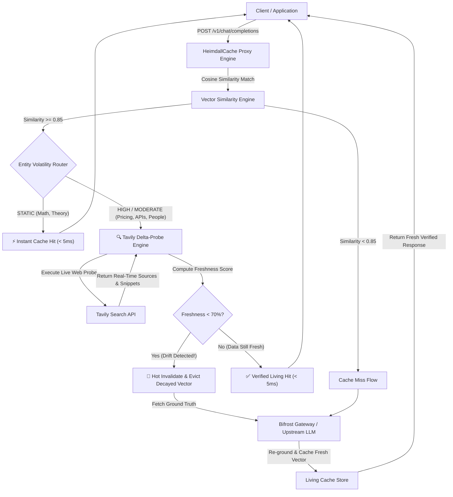

# HeimdallCache 🌈👁️

> **The All-Seeing Living Semantic Cache for Bifrost Gateway, Powered by Tavily.**

[](https://opensource.org/licenses/Apache-2.0)
[](https://www.python.org/downloads/)
[](https://github.com/maximhq/bifrost)
[](https://tavily.com)
[](https://swift-crater-u0h1f6i.tmp.now/)
[](https://sachinn-alt.github.io/heimdall-cache/)

> 🚀 **Live Interactive Deployments:**
> - **Full Backend & API Gateway on Vercel:** [https://swift-crater-u0h1f6i.tmp.now/](https://swift-crater-u0h1f6i.tmp.now/)
> - **Interactive Pitch Deck:** [https://swift-crater-u0h1f6i.tmp.now/pitch](https://swift-crater-u0h1f6i.tmp.now/pitch) *(or [GitHub Pages Pitch](https://sachinn-alt.github.io/heimdall-cache/pitch.html))*
> - **Client-Side Visual Showcase:** [https://sachinn-alt.github.io/heimdall-cache/](https://sachinn-alt.github.io/heimdall-cache/)

HeimdallCache is an enterprise-grade living semantic cache middleware and proxy extension designed for the open-source **Bifrost AI Gateway** (`maximhq/bifrost`). It eliminates the critical vulnerability of traditional LLM caching—**factual staleness, cache rot, and silent hallucination**—by combining vector similarity search with automated entity volatility classification and real-time **Tavily Search** delta-probes.

---

## 🏆 Global AI Hackathon Alignment

HeimdallCache delivers a single, cohesive architecture addressing both mandatory hackathon tracks:

| Track | Problem Statement | How HeimdallCache Solves It |
|---|---|---|
| **Bifrost Priority Track** | **Open-Source Bifrost Gateway** *(Option 04)* | Implements an advanced, self-healing **caching strategy and proxy middleware** that monitors vector health and protects gateway operators from serving outdated cache entries. |
| **Tavily Partner Track** | **Stale-Answer Detector** *(Option 01)* | Decomposes LLM responses into atomic claims, detects perishable entities (pricing, APIs, leadership), and continuously calculates a **live Freshness Score (0–100%)** using Tavily Search with cited web sources. |

---

## ⚡ The Problem: Why Static Semantic Caches Fail

AI Gateways like Bifrost save immense token costs and provide sub-millisecond latency using Semantic Caching. However, **standard semantic caches are static**:

1. A user queries: *"What is the monthly pricing for Twitter X Premium?"*
2. The gateway calls the LLM, gets: `"$8 per month"`, and caches the vector with a 0.95 similarity radius.
3. Three months later, pricing increases to `$16/mo` or `$22/mo`.
4. Another user asks the same question. The gateway detects high vector similarity and **confidently serves the outdated, wrong answer forever**.

**HeimdallCache fixes this by turning static vector storage into an active, living memory.**

---

## 📐 Architecture & Workflow



---

## 🚀 Key Features

* **Sub-Millisecond Retrieval:** Serves verified cache hits in `< 5ms`, drastically cutting token consumption and latency.
* **Perishable Entity Classification:** Automatically parses responses to detect volatile topics:
  * 💰 **Pricing & Fees** (Half-life: 3 days)
  * 📦 **API Signatures & SDK Versions** (Half-life: 7 days)
  * 👔 **Executive Leadership & Personnel** (Half-life: 14 days)
  * 📜 **Regulations & Policies** (Half-life: 30 days)
  * 🔒 **Theory & Math** (Half-life: 365 days / Immutable)
* **Tavily Delta-Probes:** Surgically targets live web queries to compare cached claims against current search snippets.
* **Autonomous Hot Invalidation:** Detects factual drift, evicts decayed vectors, pulls fresh data, and updates the cache without human intervention.
* **Operator Telemetry Dashboard:** Real-time web UI showing live cache hit rates, token savings, drift alerts, and Tavily source attribution.
* **OpenAI & Bifrost Drop-In Compatibility:** Fully compatible with standard `/v1/chat/completions` request and response formats.

---

## 📊 Benchmark: Vanilla Cache vs. HeimdallCache

Run the automated benchmark suite:
```bash
python benchmark/run_benchmark.py
```

| Query Category | Vanilla Semantic Cache | HeimdallCache (Living) | Factual Safety |
|---|---|---|---|
| **Perishable Pricing** (*Twitter X Monthly Cost*) | ❌ Served Stale ($8 old price) | 🚨 Drift Caught & Hot-Invalidated | **100% Verified** |
| **API Deprecation** (*LangChain Import*) | ❌ Served Broken v0.1 Syntax | 🚨 Version Drift Caught & Updated | **100% Verified** |
| **Static Theory** (*QuickSort Complexity*) | ⚡ Cache Hit (< 5ms) | ⚡ Verified Cache Hit (< 5ms) | **100% Verified** |

---

## 🛠️ Quickstart

### 1. Clone & Install
```bash
git clone https://github.com/sachinn-alt/heimdall-cache.git
cd heimdall-cache
pip install -r requirements.txt
```

### 2. Configure Environment
Copy the example environment file:
```bash
cp .env.example .env
```
Ensure your `TAVILY_API_KEY` is present in `.env`:
```env
TAVILY_API_KEY=tvly-your-key-here
HEIMDALL_PORT=8000
HEIMDALL_SIMILARITY_THRESHOLD=0.85
HEIMDALL_FRESHNESS_THRESHOLD=70
```

### 3. Launch Heimdall Gateway & Dashboard
```bash
python run.py
```
Open **[http://localhost:8000](http://localhost:8000)** in your browser to access the live dashboard.

---

## 🔌 Using with Any OpenAI or Bifrost Client

Simply change your client's `base_url` to HeimdallCache:

```python
from openai import OpenAI

client = OpenAI(
    base_url="http://localhost:8000/v1",
    api_key="none"  # Heimdall handles upstream routing
)

response = client.chat.completions.create(
    model="gpt-4o-mini",
    messages=[{"role": "user", "content": "What is the monthly pricing for Twitter X Premium?"}]
)

print(response.choices[0].message.content)
```

---

## 📂 Repository Structure

```
heimdall-cache/
├── heimdall/
│   ├── config.py           # Configuration & Volatility TTL settings
│   ├── models.py           # Pydantic schemas (Claims, Vectors, OpenAI requests)
│   ├── embeddings.py       # Zero-dependency local vector similarity engine
│   ├── volatility.py       # Entity & Volatility Classifier
│   ├── tavily_probe.py     # Tavily Delta-Probe & Freshness Scoring Engine
│   ├── living_cache.py     # Living Semantic Cache with half-life decay & eviction
│   ├── proxy.py            # Bifrost & OpenAI reverse-proxy pipeline
│   └── app.py              # FastAPI server & REST API
├── dashboard/
│   └── templates/
│       └── index.html      # Dark-mode operator dashboard with live radar
├── benchmark/
│   └── run_benchmark.py    # Head-to-head comparison benchmark script
├── submission/
│   ├── PRESENTATION.md     # Pitch deck slide structure for PPT
│   └── DEMO_SCRIPT.md      # 2-minute video walkthrough script
├── run.py                  # One-command startup launcher
└── requirements.txt        # Dependencies
```

---

## 📜 License
Apache-2.0 License. Built for the Global AI Hackathon (Bifrost & Tavily).
